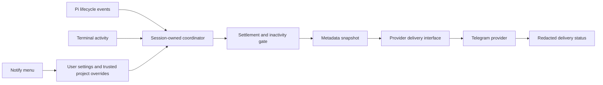

# pi-notify Telegram implementation plan

## Goal

Add an independently installable `@narumitw/pi-notify` extension that sends Telegram notifications when Pi stops automatic work. Identify the computer, session, and Git worktree so the user can return to review the result. Provide a menu-first `/notify` command and canonical `pi-notify.json` settings, including an optional inactivity delay.

Implementation and local verification are complete on `narumi/feat/pi-notify`. Live Telegram verification remains blocked because no approved test credentials and chat were supplied. This plan does not authorize publication or live messages and stays open until the remaining acceptance checks are resolved.

## Context

Follow `docs/extension-conventions.md`, `docs/extension-settings.md`, and `docs/readme-conventions.md`.

The installed Pi API exposes `agent_settled` with an `aborted` flag. Its contract says no automatic retry, compaction, or queued continuation will run. `agent_end` is only a low-level run boundary. The official `examples/extensions/notify.ts` also uses `agent_settled` for ready-for-input notifications.

Session metadata is available through `ctx.sessionManager.getSessionId()` and `getSessionName()`. Use `ctx.cwd` for the active working directory. Obtain Git metadata directly, without depending on another extension.

`ctx.ui.onTerminalInput()` provides terminal input observation. There is no `ctx.ui.isUserWatching()` API. Terminal focus reporting is optional and does not prove that a user is reading. A window can retain focus when the user leaves the computer.

## Scope

Support Telegram Bot API destinations: private chats, groups, and supergroups. Support multiple selected Telegram destinations. Confirm forum topic support through `message_thread_id` during API discovery before finalizing that optional field.

Implement a small provider-neutral delivery boundary, with Telegram as its only registered provider. Gotify, Slack, Discord, generic webhooks, shell commands, desktop notifications, two-way messaging, remote control, transcript summaries, OS idle detection, and screen-lock detection remain outside this release. Do not add placeholder providers, dynamic plugin loading, provider-specific environment variables, or a provider-selection screen with only one choice.

## Product behavior

### Notification modes

Expose two modes in `/notify` Settings:

1. `immediate`: attempt notification when the work period settles. This is the default mode; the extension itself remains disabled until explicitly enabled.
2. `after-inactivity`: notify only when the work period has settled and the configured time since the last observed activity has elapsed.

Use a proposed inactivity default of 30 seconds. Offer 30 seconds, 1 minute, 2 minutes, and a custom positive whole-second value. Validate custom values against an implementation-documented finite timer range. Show this setting as inactive when the notification mode is `immediate`.

For TUI inactivity behavior:

- Record activity from actual user input, not terminal capability replies, mouse-motion noise, or focus-loss events. Derive input classification from the installed terminal runtime and test its relevant branches.
- Initialize the activity baseline when the session starts. If activity observation is newly attached, initialize it then rather than assuming the user has already been away.
- At `agent_settled`, send immediately if inactivity already meets the threshold; otherwise start a timer for the remaining time. Do not restart a full delay unconditionally.
- If user activity occurs while waiting, cancel that work period's pending reminder. Do not rearm it later merely because the user becomes inactive again.
- If a new work period starts while waiting, cancel the old pending reminder and evaluate the next settlement separately.
- A focus-gain event counts only when Pi forwards it through `ctx.ui.onTerminalInput()`. Fullscreen Pi consumes focus, mouse, and viewport/search input before extension listeners; these actions do not reliably cancel a reminder. Terminal support alone is not sufficient. Focus loss alone does not trigger delivery. A continuously focused window does not suppress delivery.
- Use existing focus reporting only when available through the supported input path. Do not emit terminal control sequences or take ownership of the host's focus-reporting mode. Correct operation must not require focus support.
- Revalidate the session generation, pending work-period identity, current settings, cancellation state, and absence of newly started work before sending when the timer expires.
- Changing enablement, mode, delay, or selected destinations cancels any pending reminder. Do not send an old reminder to a newly selected chat. The new policy applies to subsequent work periods.

In RPC, print, and JSON modes, terminal inactivity cannot be observed. Deliver at settlement even when `after-inactivity` is configured, and document this fallback in Settings Help and the README. Do not pretend to observe the remote client's activity.

This mode measures activity, not attention. A user reading without typing can still receive a reminder. It is not a cooldown and does not suppress notifications for unrelated settled work periods after delivery has started.

### Settlement policy

- Send at most one automatic delivery attempt per selected destination per eligible work period.
- Do not notify during intermediate tool calls, retry attempts, compaction, queued continuations, session loading, or `/notify` actions.
- Notify after normal settlement and terminal provider failure. Use neutral wording such as `Pi is ready for review`; do not claim the user's task succeeded.
- Suppress user-aborted work periods. Do not add an abort-policy setting in this release.
- Do not notify when Pi opens an interactive confirmation. Attention-required notifications are a separate future feature.
- Keep deduplication in session memory. Session start and reload must not replay historical results. Do not claim exactly-once remote delivery.

Observe work start and final settlement without changing prompts, tools, messages, or continuation policy. Confirm runtime branches before implementation, including failures before `agent_start`, repeated starts during recovery, user abort during retry waits, and immediate continuation from another extension. Elapsed time covers the whole observed work period, not only its last retry.

### Notification content

Send bounded plain text containing state, hostname, session name and ID, working directory, repository name, worktree path, branch or detached HEAD identifier, settlement timestamp with timezone, and observed elapsed time when available. Shorten the home-directory prefix to `~` where possible.

```text
Pi is ready for review
Computer: dev-laptop
Session: add-login (01abc...)
Workspace: ~/src/app-worktrees/add-login
Repository: app
Worktree: ~/src/app-worktrees/add-login
Branch: feat/add-login
Elapsed: 2m 18s
Stopped: 2026-10-16T14:32:05+08:00
```

Use the settlement timestamp, not the delayed delivery time. Omit unavailable fields. Missing Git, deleted directories, unnamed sessions, in-memory sessions, and detached HEAD must not prevent delivery. Bound Git subprocess time and output. Do not send remotes, prompts, assistant answers, code, tool output, raw error bodies, or credentials. Do not interpret dynamic text as Telegram Markdown or HTML; disable link previews and document that metadata itself can be sensitive.

### `/notify` menu

Use existing `@narumitw/pi-tui-kit` menu and settings APIs, with Pi-native input or Kit masked secret input as appropriate. Do not implement another menu framework.

The main menu shows effective enablement, notification mode, selected destination labels, and edited scope. Provide these actions:

1. Telegram destinations: add, edit, select, and remove destinations. Collect a label, bot token, chat ID, and optional supported forum topic. Show credential presence, never its value.
2. Send test: select a destination, preview disclosed metadata, and confirm before sending a visibly labeled test. Tests bypass the inactivity delay and do not alter automatic notification state.
3. Settings: enable notifications, choose mode, set inactivity time, and select destinations. Keep selection position across immediate saves.
4. Status: show settings paths and effective sources, credential presence, pending reminder time when applicable, and the latest per-destination delivery result.
5. Help: explain BotFather setup, how to obtain a chat ID, group permissions, privacy, mode limitations, and reload behavior.

Destination creation and editing are transactional: validate the draft and save only after explicit confirmation. Escape or Ctrl+C discards an unsaved draft. Ordinary Settings changes persist immediately; closing the screen does not undo earlier saved changes. Confirm destination removal and show affected selections; block removal when the effective trusted project selection still references it until that selection is changed. Clear user selections atomically with user destination removal, without modifying unrelated projects.

Start with no textual subcommands and reject non-empty arguments. TUI is the interactive configuration surface. RPC receives an observable notice with manual settings instructions instead of opening custom TUI. Do not claim slash-command configuration support in print or JSON mode. Automatic notification delivery is UI-independent, subject to the documented inactivity fallback.

## Architecture



Keep `src/index.ts` as a thin default-export forwarder and registration in `src/notify.ts`. Separate settings, menu, metadata, notification coordination, and Telegram transport only where responsibilities make changes or tests clearer. Keep package tests under `packages/pi-notify/test/`.

### Provider boundary

Keep notification policy in the session coordinator and service behavior in a provider module. Use one small `NotificationProvider` contract and an explicit built-in provider map; register only `telegram`.

The contract must cover:

- A stable provider ID and display label.
- Runtime validation of that provider's destination settings.
- Cancellable `send(destination, notification, signal)` returning a normalized delivery result.

Use a provider-neutral notification value containing a stable work-period ID, title, plain-text body, and settlement timestamp. The coordinator builds this value once; providers must not read sessions, collect metadata, change settings, own inactivity timers, or decide when to notify. The Telegram provider owns its API request, message-size adaptation, and safe response interpretation.

Normalize results to accepted, failed, or cancelled, with a safe error code and optional retry-after duration. Acceptance means the service accepted the message, not that a user read it. Do not return raw transport exceptions, tokens, URLs, or response bodies. The coordinator owns delivery status, fan-out, cancellation, and the one-attempt policy; a retry-after value does not enable automatic retries.

Represent destinations as a discriminated union keyed by `provider`. The first release has only the Telegram member. Keep destination labels and IDs common, with provider-specific credentials and addresses owned by that member. Reject unsupported provider IDs before delivery, report them safely, and preserve their raw fields during unrelated settings saves. Do not silently substitute Telegram.

Keep provider-specific setup UI in the extension's Telegram setup flow. Do not require providers to implement a generic form schema or import TUI APIs. Settings validation and transport must use the same provider-owned validator. Add another union member and provider-map entry only when its implementation is approved.

Use native `fetch` and platform APIs. No Telegram SDK, model tool, daemon, background polling, or model inference is required. Chat IDs are entered through the menu; automatic chat discovery is not required for the first release.

### Settings and credentials

Use these canonical paths through `getAgentDir()` and `CONFIG_DIR_NAME`:

```text
<getAgentDir()>/pi-notify.json
<workspace>/<CONFIG_DIR_NAME>/pi-notify.json
```

Defaults are disabled, `immediate` mode, 30-second inactivity time, no destinations, and no selected IDs. Loading defaults must not create files. Proposed user settings:

```json
{
  "enabled": true,
  "mode": "after-inactivity",
  "inactivitySeconds": 30,
  "targetIds": ["personal"],
  "destinations": {
    "personal": {
      "provider": "telegram",
      "label": "Personal Telegram",
      "botToken": "<secret>",
      "chatId": "123456789"
    }
  }
}
```

Require `provider: "telegram"` for Telegram destinations. This is the only supported provider ID in the first release. Store chat IDs as strings to preserve negative group IDs and avoid JSON numeric precision issues.

Project settings may override only `enabled`, `mode`, `inactivitySeconds`, and `targetIds`, referencing user-owned Telegram destinations. They cannot define credentials, endpoints, destination addresses, or labels. Ignore project settings unless `ctx.isProjectTrusted()` is true. Resolve defaults, user settings, then trusted project overrides; target arrays replace rather than merge. Reject unknown target references with an actionable error and do not silently route elsewhere.

Identify User or Project scope before saving. Project saves contain only explicit overrides and can remove an override to restore inheritance. Destination management is always user-scoped.

Use private POSIX permissions (`0600`) for user settings. Preserve unknown fields, reject malformed existing files on write, serialize same-path read-modify-write operations, and publish through a temporary file plus rename. Keep previous effective settings and displayed values after failure. Await pending writes before dependent reload and shutdown. Document in-process ordering only; simultaneous edits from separate Pi processes are not guaranteed conflict-free.

Reload settings on `session_start`, including `/reload`. Successful menu saves apply immediately. Manual file edits take effect on the next session start or reload. No file watcher is needed.

### Delivery and lifecycle ownership

Own resources by `sessionManager` and a generation guard, not `ctx.ui`. Each pending reminder owns its timer and work-period identity. Snapshot settlement metadata before delayed delivery without retaining a stale context. Release input subscriptions, timers, metadata subprocesses, requests, and menu tasks on their owning cancellation, disposal, replacement, reload, and shutdown paths.

Schedule background delivery without awaiting network work inside the settlement handler. Use finite cancellable HTTP requests to Telegram's fixed HTTPS API origin, reject redirects, and inspect Telegram's JSON success flag as well as HTTP status. Bound response-body reads and notification size. One destination's failure must not prevent another's attempt or fail the coding run.

Cancel pending reminders when a new work period begins, but do not cancel a delivery attempt already started merely because the user begins new work. Prevent old completions from overwriting newer delivery status. Cancellation cannot recall a message already accepted by Telegram.

Use one attempt per delivery. Do not retry ambiguous network failures automatically. Report rate limits and allow explicit tests; do not add a durable outbox or replay. Keep bounded, redacted status in memory. Never display bot-token URL paths, headers, request bodies, raw Telegram response bodies, or unsanitized fetch errors.

Shutdown cancels owned work and awaits bounded cleanup, not indefinite delivery flushing. Immediate process exit may prevent in-flight notifications, especially in short-lived headless sessions. Document best-effort delivery without claiming guaranteed headless delivery.

## Applicable rules and verification

Apply these touched-area MUST rules before implementation:

| Area | Required rules | Named verification |
| --- | --- | --- |
| Package | Independent package, thin forwarder, one entrypoint, correct runtime dependencies and Pi peers, root entry registration, packed files and license, Changeset | `Validator`: boundaries and typecheck; `Review`: metadata and release intent; `Smoke`: pack and Pi load |
| Lifecycle | No factory-started work; idempotent cleanup; no stale contexts; cancel and release every owned task | `Test`: timers, delayed continuations, cancellation, replacement, reload, shutdown; `Review`: every await and resource |
| Commands | Document arguments and modes; reject unknown input; no generic `/settings`; observable supported non-TUI behavior | `Test`: arguments and each claimed mode; `Review`: public surface |
| TUI | TUI-only custom screens; callback theme and keybindings; bounded framed rendering; focus propagation; disposal cancels tasks | `Test`: narrow and zero widths, constrained heights, resize, non-default keybindings, editing/paste, cancellation; `Review`: ownership |
| Settings | Canonical files, trust gate, runtime validation, unknown-field preservation, ordered atomic writes, failure rollback, private secrets | `Test`: settings guide checklist and pending-reminder policy changes; `Review`: reads and writes together |
| Privacy | No secrets in display, logs, notifications, errors, or project files; sanitize terminal text | `Test`: redaction and hostile names/paths; `Review`: outbound fields |
| Documentation | Required README structure, accurate interfaces, installation and disclosure warnings, settings paths and limitations | `Review`: README checklist and fenced-code-aware heading audit |
| Verification | Deterministic tests, both root gates, package inspection, runtime smoke | `Validator`: `npm run check`; `Test`: `npm test`; `Smoke`: pack, Pi load, approved Telegram delivery |

No model-visible prefix transition is intended. Verify that no tools, context hooks, or model-visible messages are added. Avoid a permanent ready indicator. If needed for active delivery or failures, use the stable `notify` status key and clear owned status on teardown.

## Plan

- [x] Verify current lifecycle and terminal-input contracts plus official Telegram setup, topic fields, payload limits, response errors, and rate limits. Evidence: named source references and table-driven branch cases, including startup without activity, focus/capability input, failure before `agent_start`, recovery, and abort; no live messages without approval.
- [x] Create `packages/pi-notify` with entrypoint, manifest, license, TypeScript configuration, root registration, and Changeset. Evidence: boundaries and independent pack metadata review.
- [x] Implement settings validation and ordered atomic persistence with trusted project overrides. Evidence: missing and malformed files, permissions, unknown fields, precedence, stale reads, save failures, destination removal, and recovery tests.
- [x] Implement settled work-period tracking, safe metadata snapshots, and both notification modes. Evidence: fake-clock tests for elapsed inactivity, remaining delay, activity cancellation, focus gain, restart, policy change, abort, duplicate events, headless fallback, cleanup, and missing Git.
- [x] Define the provider-neutral notification, destination discriminator, provider contract, explicit provider map, and normalized results. Evidence: contract tests with a fake provider prove policy/transport separation, signal propagation, unsupported-provider handling, safe errors, and status isolation without implementing a second service.
- [x] Implement Telegram as the sole production provider with bounded cancellable delivery. Evidence: mocked HTTP and API success/failure, rate limit, timeout, body limits, redirect rejection, partial destination failure, and redaction tests.
- [x] Implement `/notify` Telegram setup, test confirmation, Settings, Status, and Help with existing Kit APIs. Evidence: transactional cancel, save rollback, inheritance, masked input, custom inactivity validation, non-default keybindings, constrained rendering, non-TUI behavior, and disposal tests.
- [x] Document installation, Telegram prerequisites, exact outbound data, inactivity semantics, settings scope, headless fallback, best-effort delivery, and recovery. Evidence: README audit against implementation and applicable guides.
- [ ] Run root gates, inspect the package tarball, and smoke Pi loading and an approved Telegram notification. Evidence: recorded command results; unavailable external checks remain open until resolved or explicitly accepted.

## Completion Checklist

- [x] `/notify` can configure Telegram destinations, enablement, mode, and inactivity duration without manual JSON editing; secrets never appear in previews or status.
- [x] Eligible settled work periods produce at most one attempt per selected destination, with no premature notification during automatic continuation.
- [x] Inactivity mode uses time since last forwarded activity, waits only the remaining interval, cancels on observed input or new work, and never claims to detect reading. Fullscreen input-consumption limits are documented and tested.
- [x] The coordinator uses only the common provider contract for delivery; Telegram is the sole production provider, and fake-provider tests verify dispatch, cancellation, safe results, and unsupported-provider behavior.
- [x] Notifications identify the computer, session, and worktree when available, without claiming task success or transmitting conversation content.
- [x] Cancellation, disposal, failure, policy changes, reload, replacement, shutdown, and delayed completion do not leak tasks or corrupt settings/status.
- [x] `npm run check` and `npm test` pass; root build rebuilds Kit before consumer tests, without running root checks concurrently with a separate Kit build.
- [x] `npm run package:pack -- notify` passes and its inspected tarball contains an independently installable package.
- [x] `npm --workspace @narumitw/pi-notify run build --if-present` and `pi -e ./packages/pi-notify` pass their applicable runtime smoke paths.
- [ ] Live Telegram smoke has explicit approval and recorded results, or its absence is accepted with precise unverified paths; stop after one clear external entitlement failure and use deterministic tests.
- [x] Final diff passes the guides' semantic audit, and handoff names checks, smokes, deviations, and unverified paths; no publication, visibility change, version tag, or release dispatch occurs without explicit approval. Evidence: draft PR #1588 records local verification and the live-smoke blocker.

## Verification evidence

- `npm install` and `npm ls @narumitw/pi-tui-kit` passed; the new consumer resolves the published Kit floor.
- `npm run check` passed with builds, Biome, package boundaries, and every workspace typecheck.
- `npm test` passed: 609 files passed, one skipped; 8,803 tests passed, two skipped. The skipped cases are outside this package. All 121 new package tests passed.
- `npm run package:pack -- notify` passed. An actual `npm pack --workspace @narumitw/pi-notify` tarball was inspected: 14 intended files, with no tests or credentials.
- `npm --workspace @narumitw/pi-notify run build --if-present` passed; the source-loaded package has no package build.
- Package-directory `pi -e ./packages/pi-notify` was exercised non-interactively through RPC with isolated settings and discovery disabled. Command discovery, two `/notify` notices across session replacement, JSONL integrity, side-effect-free missing settings, and orderly shutdown passed without model or Telegram calls.
- The Pi `DefaultResourceLoader` test passed through Jiti, including the lazy TUI menu import and repeated cleanup. A fenced-code-aware heading audit passed for all 36 package READMEs.
- Semantic review covered correctness, fixed-origin credential handling, redaction, per-await ownership, timer/request/subprocess/menu disposal, settings lock order and atomic failure recovery, User/Project isolation, prompt-prefix stability, compatibility, and scope. No model tools, context transformations, extension coupling, or new provider implementations were added.
- Accepted implementation details are documented: zero-width guarding around Kit screens; cancellation of a running test closes its menu; non-TUI inactivity falls back to settlement; headless delivery is best effort; settings are not cross-process locked.
- Unverified: real Telegram token/chat permissions, private/group/forum delivery, actual terminal focus and mouse behavior through SSH/tmux, and physical terminal interaction. Terminal flows have harness coverage, not a human-operated terminal smoke.
- Blocked: live Telegram smoke requires an approved Bot token and destination chat. No credentials were searched for and no real Telegram message was sent. Absence of that smoke has not been accepted, so its task and completion criterion remain open.
- npm registry lookup returned 404 for the new package. Documentation uses local checkout installation until publication; no publication, visibility change, tag creation, or release dispatch was performed.
- PR: https://github.com/narumiruna/pi-extensions/pull/1588, based on `main`, with original implementation commit `2d539618`. It is ready for review, not draft. The PR records verification, risks, and open live-smoke acceptance. This plan remains saved because that acceptance is still open.
- A human-operated terminal smoke is impractical in this non-interactive harness. Kit harness and Pi Jiti tests verify loading and interactions but do not establish real terminal focus/mouse delivery.

## Review ledger — PR #1588

Reviewed head: `e804e1bddc26e311700ae74c26c5e00b23fe1ed1`. The checkout and PR both belong to `narumiruna/pi-extensions`. The PR is open and ready; its prior CI run passed. All REST pages and GraphQL thread/comment pages were fetched. The original implementation diff and relevant instructions are unchanged from the prior review. Source review is reused where unchanged; the reported failure classes are checked again across settings mutations, activity classification, UI, tests, and documentation.

| Item | Evidence and relation to the goal | Severity | Outcome |
| --- | --- | --- | --- |
| R1: comment `4295840699` | `saveDestination()` converts any non-object `destinations` value to `{}`. This can discard stored data during Telegram setup. Existing destination entries also need protection from non-object replacement. Both affect the new settings contract. | P2 | Already addressed in published commit `23a47dda`. The fix rejects destructive coercion. Eleven tests verify unchanged data/state and recovery. Evidence was posted in reply `4296018232`; the Resolve API returned `isResolved: true`. |
| R2: comment `4295840709` | Installed `TuiAltScreen` registers its viewport listener in its constructor. It consumes focus, mouse, and viewport/search keys before `onTerminalInput()` subscriptions. The current docs promise more activity coverage than the public hook provides. | P2 | Already addressed in published commit `23a47dda` with the supported-behavior alternative. UI/docs state the public observer limits. Seventy-three installed-runtime cases cover routing and cancellation. Evidence was posted in reply `4296018609`; the Resolve API returned `isResolved: true`. |
| Review receipt `5549327701` and summary `6217740470` | These identify the reviewed commit and the same two findings. They add no separate code request. | Informational | Already addressed by tracking R1 and R2. No duplicate reply is needed. |
| Prior draft-status question | GitHub now reports `isDraft: false`. The description still says Draft blocker. Missing live credentials remain a verification limit, not a reason to change the PR back to draft. | P3 | Already addressed. The PR remains ready for review. Its description now labels the missing live test as unverified integration rather than a draft blocker. No readiness change or new approval request was made. |

Touched rules and verification: settings changes MUST protect invalid files, preserve unknown data, serialize mutations, and recover after failure (`Test`, `Review`); input behavior MUST be based on installed listener branches and must not depend on private host state (`Test`, `Review`); UI/docs MUST state supported behavior and keep mode, cancellation, framing, and credential rules (`Test`, `Review`); both repository gates and applicable package/runtime checks remain required (`Validator`, `Test`, `Smoke`). No raw stdin observer or host listener reordering will be added.

### Review validation

- `npm run check` passed. `npm test` passed: 8,887 tests passed, two skipped; 610 files passed, one skipped. All 205 package tests passed without skips.
- Eleven new settings cases cover arrays, strings, null, numbers, and booleans in stored collections and entries. They check unchanged file bytes, unchanged effective state, no temporary-file residue, and save recovery after manual repair.
- Seventy-three installed-runtime routing cases use real Pi regular/fullscreen renderers, public terminal input, and fake-clock reminder checks. They cover normal text/paste, key releases, focus, mouse, wheel, viewport keys, search, overlays, and prior-listener consumption. No private host state is accessed.
- `npm run package:pack -- notify` passed. The actual tarball contains the same 14 intended source/documentation/license files and no tests or credentials.
- Package build-if-present and the isolated `pi -e ./packages/pi-notify` RPC check passed. The Jiti menu test passed in the package suite. The heading audit passed for all 36 package READMEs. `git diff --check` passed.
- The settings mutation paths and all activity claims in this PR were checked. Cleanup and signal ownership are unchanged. Existing package Changeset coverage remains sufficient. No API, settings key, provider, permission, or dependency was added.
- Live Telegram delivery and physical terminal behavior remain unverified for the reasons already recorded above. They do not prevent responding to these two verified review items.
- Both review replies were published after validation and push. Both Resolve API calls returned `isResolved: true`. The PR description records the fix commit, current test totals, support limits, and ready status. No review item is deferred or needs clarification.

## Rollback / Recovery

Disable notifications in the effective Settings scope, including any trusted project override that enables them. Disabling cancels pending reminders. Unload the extension to stop its owned delivery work; accepted messages cannot be recalled. If a token is exposed, revoke it through BotFather before replacing the user setting. Repair malformed settings manually instead of overwriting them with defaults. This release changes no Telegram resources beyond explicitly requested messages.
